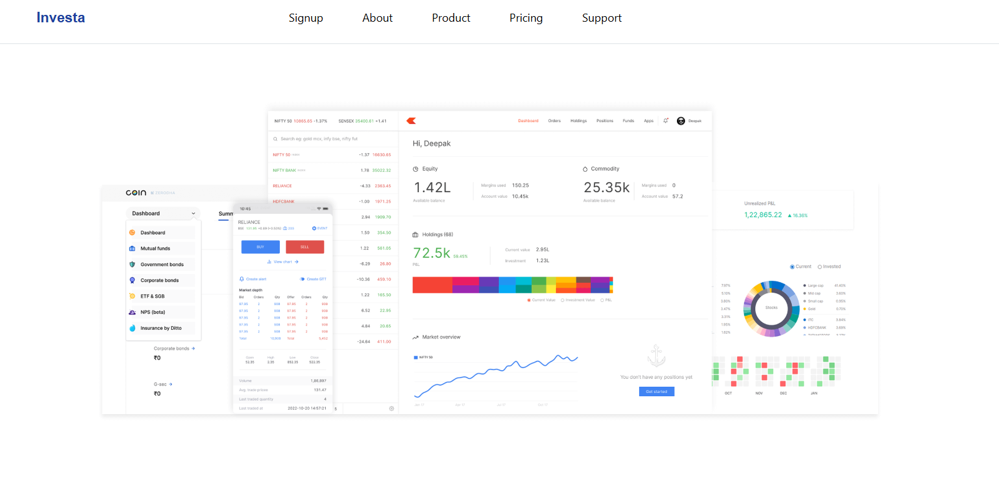
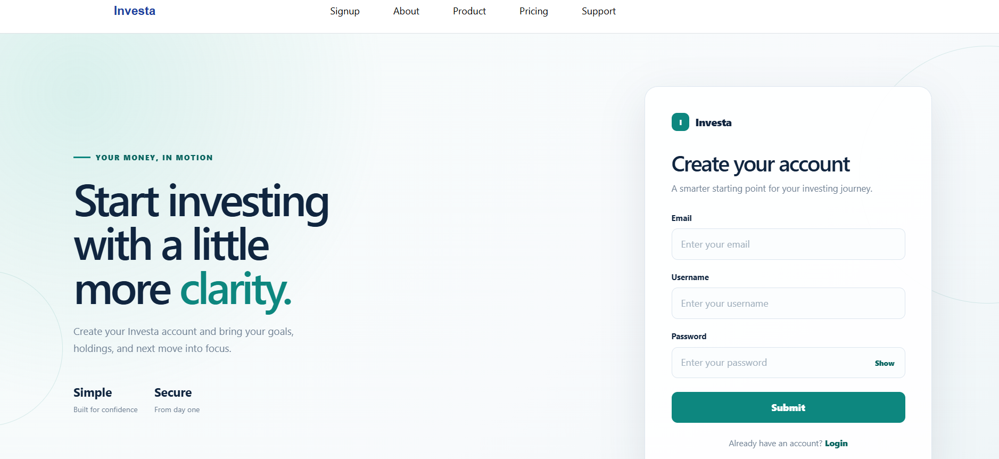
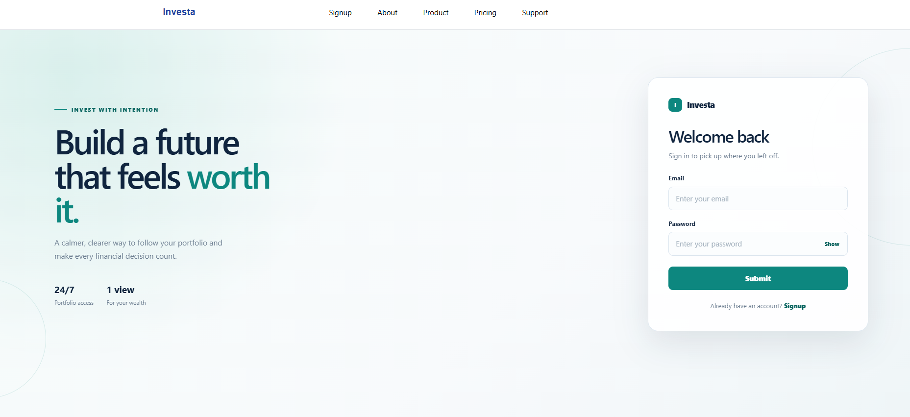
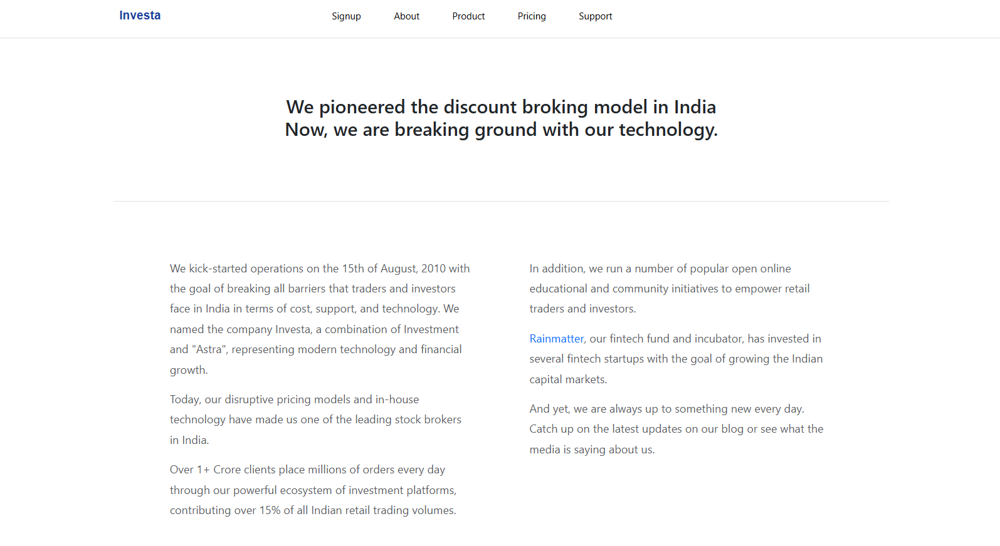
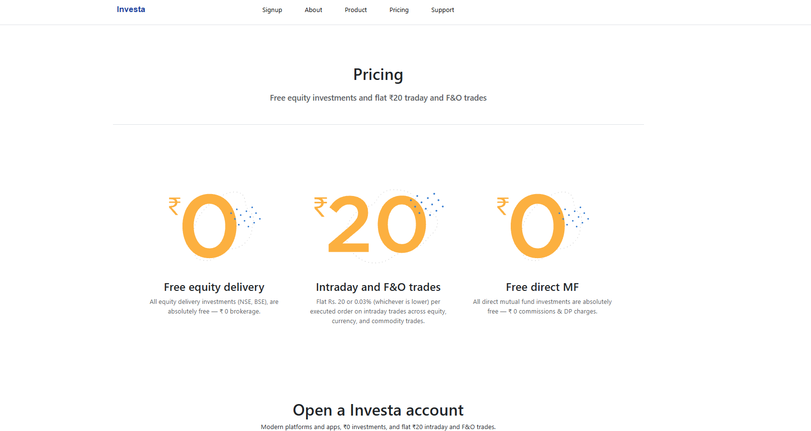
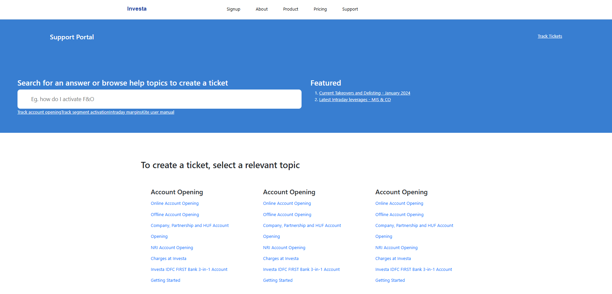
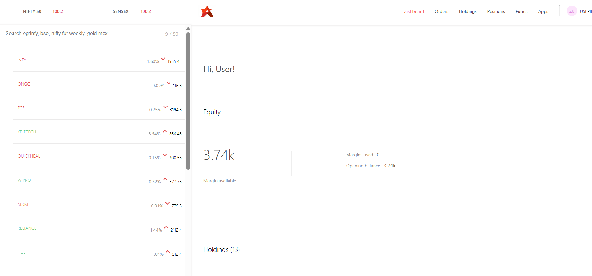

# Investa — Full-Stack Stock Trading Platform

> **Live Demo:** [https://zenvest-i92g.vercel.app/](https://zenvest-i92g.vercel.app/)
>
> **GitHub Repository:** [Dhanshree0304/Investa](https://github.com/Dhanshree0304/Investa)

Investa is a full-stack stock trading platform inspired by modern brokerage applications. It provides a user interface for authentication, viewing stock holdings and positions, tracking stocks, and managing orders through an integrated frontend, dashboard, and backend.

## 🚀 Project Overview

- **Project Name:** Investa
- **Repository:** [Dhanshree0304/Investa](https://github.com/Dhanshree0304/Investa)
- **Architecture:** MERN Stack
- **Frontend:** React.js
- **Dashboard:** React.js
- **Backend:** Node.js and Express.js
- **Database:** MongoDB
- **Testing:** Jest and React Testing Library
- **CI/CD:** GitHub Actions
- **Deployment:** Vercel and Render
- **Live Demo:** [Open Investa](https://zenvest-i92g.vercel.app/)

## ✨ Features

- **User Authentication:** User signup and login with password hashing.
- **Protected Routes:** Restrict access to authenticated users.
- **Holdings Management:** View stock holdings and portfolio information.
- **Positions Management:** Display trading positions.
- **Order Management:** Submit orders through backend APIs.
- **Watchlist:** Track stocks through the dashboard.
- **Portfolio Analytics:** View portfolio summaries and graphical representations.
- **Informational Pages:** Home, About, Pricing, and Support Portal pages.
- **REST API Integration:** Communicate between the frontend, dashboard, and backend.
- **Automated Testing:** Run tests to detect issues before deployment.
- **Cloud Deployment:** Deploy application components separately.
- **CI/CD Automation:** Automate code checks and builds using GitHub Actions.

## 🖼️ Screenshots

**Live website:** [https://zenvest-i92g.vercel.app/](https://zenvest-i92g.vercel.app/)

### Website

**Home Page**



| Signup | Login |
|---|---|
|  |  |

| About | Pricing |
|---|---|
|  |  |

**Support Portal**



### Dashboard

Shows the watchlist (NIFTY 50, SENSEX, INFY, TCS, RELIANCE and more), equity margin summary, and holdings overview after login.



## 🛠️ Tech Stack

| Category | Technologies |
|---|---|
| Frontend | React.js, HTML5, CSS3, JavaScript |
| Dashboard | React.js, Chart.js |
| Backend | Node.js, Express.js |
| Database | MongoDB, Mongoose |
| Authentication | bcrypt, token-based authentication |
| API Communication | REST APIs, Axios |
| Testing | Jest, React Testing Library |
| CI/CD | GitHub Actions |
| Deployment | Vercel, Render |
| Version Control | Git, GitHub |

## 📂 Project Structure

```text
Investa/
├── frontend/
│   ├── public/
│   ├── src/
│   ├── package.json
│   └── .env
│
├── backend/
│   ├── models/
│   ├── routes/
│   ├── package.json
│   └── .env
│
├── dashboard/
│   ├── public/
│   ├── src/
│   └── package.json
│
├── docs/
│   └── screenshots/
│       ├── website-home.png
│       ├── signup.png
│       ├── login.png
│       ├── about.png
│       ├── pricing.png
│       ├── support.png
│       └── dashboard.png
│
├── .github/
│   └── workflows/
│       └── ci.yml
│
├── .gitignore
└── README.md
```

*Note: This is a representative structure. The actual files and folders may differ in your repository.*

## ⚙️ Installation and Setup

### Prerequisites

Install the following before running the project:

- Node.js and npm
- Git
- MongoDB Atlas account or a local MongoDB instance
- A code editor such as Visual Studio Code

### 1. Clone the Repository

```bash
git clone https://github.com/Dhanshree0304/Investa.git
cd Investa
```

### 2. Configure the Backend

```bash
cd backend
npm install
```

Create a `.env` file inside the backend directory and configure the required environment variables.

Example:

```env
MONGO_URL=your_mongodb_connection_string
PORT=3002
```

Add any other environment variables required by your implementation.

Start the backend using the script configured in `backend/package.json`. For example:

```bash
npm start
```

### 3. Configure the Frontend

Open another terminal:

```bash
cd frontend
npm install
npm start
```

Configure the frontend API base URL to point to your backend. For local development, use the appropriate localhost URL; for production, use the deployed backend URL.

### 4. Configure the Dashboard

Open another terminal:

```bash
cd dashboard
npm install
npm start
```

Ensure the dashboard uses the correct backend API URL and an available development port.

**Important:** The commands above assume that the corresponding npm scripts exist in each `package.json`. Use the scripts defined in your actual project.

## 🔐 Authentication and API Endpoints

The backend uses Express.js and MongoDB to support authentication and application data.

| Endpoint | Purpose |
|---|---|
| `/signup` | Register a new user |
| `/login` | Authenticate a user |
| `/allHoldings` | Retrieve holdings |
| `/allPositions` | Retrieve positions |
| `/newOrder` | Submit a new order |

Authentication routes may use an `/api/auth` prefix in the production configuration. Confirm the exact route paths and HTTP methods in the backend code.

## 🧪 Testing

The project uses Jest and React Testing Library to test frontend functionality.

### Run Frontend Tests

```bash
cd frontend
npm test -- --watchAll=false
```

### Run Dashboard Tests

```bash
cd dashboard
npm test -- --watchAll=false
```

### Run Backend Tests

```bash
cd backend
npm test
```

The dashboard and backend commands require a configured `test` script in their respective `package.json` files.

### Why Testing Matters

- Detect bugs early.
- Verify important application functionality.
- Prevent regressions when adding new features.
- Check code before deployment.
- Improve application reliability.

A previously reported frontend test run passed two suites and seven tests. Run the tests again to confirm the current repository status.

## 🔄 CI/CD with GitHub Actions

CI/CD stands for Continuous Integration and Continuous Delivery or Deployment.

### Continuous Integration (CI)

Continuous Integration automatically checks code changes when developers push to GitHub or create pull requests.

The typical workflow is:

1. A developer updates the application.
2. Changes are pushed to GitHub.
3. GitHub Actions checks out the repository.
4. Dependencies are installed.
5. Automated tests are executed.
6. The application build is checked.
7. GitHub Actions reports whether the checks passed or failed.

**Benefits of CI:**

- Early detection of bugs.
- Consistent automated testing.
- Reduced manual verification.
- Better collaboration.
- More reliable code changes.

### Continuous Deployment (CD)

Continuous Deployment automates the release of code after the required checks pass.

The intended deployment arrangement for Investa is:

| Component | Platform |
|---|---|
| Frontend | Vercel |
| Dashboard | Vercel |
| Backend | Render |
| CI workflow | GitHub Actions |

The Vercel and Render projects must be configured to connect to the repository. GitHub Actions can perform checks before deployment, while the hosting platforms can handle deployments automatically from GitHub.

### GitHub Actions Workflow

Create the following file:

`.github/workflows/ci.yml`

Example CI workflow for the frontend using Create React App:

```yaml
name: Frontend CI

on:
  push:
    branches:
      - main
  pull_request:
    branches:
      - main

jobs:
  test-and-build:
    runs-on: ubuntu-latest

    defaults:
      run:
        working-directory: frontend

    steps:
      - name: Checkout repository
        uses: actions/checkout@v4

      - name: Set up Node.js
        uses: actions/setup-node@v4
        with:
          node-version: 20
          cache: npm
          cache-dependency-path: frontend/package-lock.json

      - name: Install dependencies
        run: npm ci

      - name: Run tests
        run: npm test -- --watchAll=false

      - name: Build application
        run: npm run build
```

This is an example configuration. Verify that your repository uses the `main` branch, contains `frontend/package-lock.json`, supports the listed npm scripts, and is compatible with the selected Node.js version.

To extend CI to the dashboard and backend, add separate jobs that install their dependencies, run available tests, and build or validate each component.

### Configure Automated Deployment

To enable deployment after successful checks:

1. Connect the repository to Vercel for the frontend.
2. Create a separate Vercel project for the dashboard.
3. Configure the backend as a Render web service.
4. Set the correct root directory for each service.
5. Configure production environment variables.
6. Ensure the frontend and dashboard use the production backend URL.
7. Configure backend CORS to allow the deployed application origins.
8. Enable the desired GitHub deployment integration or configure a deployment step that runs only after CI succeeds.
9. Test the deployed application.

Do not assume that a successful CI run automatically deploys the application. Verify the actual hosting and workflow configuration.

## ☁️ Deployment Guide

### Deploy Frontend on Vercel

1. Sign in to Vercel.
2. Import the GitHub repository.
3. Set the project root directory to `frontend`.
4. Configure the build command based on the project scripts.
5. For Create React App, use `build` as the output directory.
6. Add the required environment variables.
7. Deploy the application.
8. Test signup, login, and API requests.

### Deploy Dashboard on Vercel

1. Create another Vercel project.
2. Import the same GitHub repository.
3. Set the root directory to `dashboard`.
4. Configure its build settings.
5. Add the required production API environment variables.
6. Deploy and verify dashboard functionality.

### Deploy Backend on Render

1. Sign in to Render.
2. Create a new Web Service.
3. Connect the GitHub repository.
4. Set the root directory to `backend`.
5. Configure the build and start commands.
6. Add the required environment variables.
7. Deploy the backend.
8. Check the deployment logs and verify the API.

Live frontend demo: [https://zenvest-i92g.vercel.app/](https://zenvest-i92g.vercel.app/)

Previously discussed backend URL:

`https://zenvest-backend-sesu.onrender.com`

Verify that this URL is still active before using it in production.

## 🔒 Security Best Practices

- Never commit `.env` files.
- Store passwords using secure hashing.
- Validate and sanitize incoming data.
- Protect authenticated routes.
- Configure CORS for trusted origins.
- Store production credentials in hosting environment settings.
- Store GitHub Actions secrets in repository or environment secrets.
- Never expose MongoDB credentials or authentication secrets in source code.
- Validate order requests on the backend.
- Avoid logging passwords, tokens, or sensitive user information.

## 🐛 Troubleshooting

### Frontend Cannot Connect to Backend

- Verify the backend deployment is running.
- Check the production API base URL.
- Inspect the browser console and Network tab.
- Verify the backend CORS configuration.
- Confirm that environment variables are correctly configured.

### Dashboard Login Fails

- Check the authentication API endpoint.
- Verify the login request and response.
- Confirm the token or cookie handling configuration.
- Check browser cookie restrictions and CORS credentials if cookie-based authentication is used.
- Inspect backend logs for errors.

### GitHub Actions Build Fails

- Read the failed step in the Actions log.
- Verify the Node.js version.
- Confirm that the lockfile and npm scripts exist.
- Fix failing tests and build errors.
- Check environment variables required during the build.

### Vercel Deployment Fails

- Confirm the project root directory.
- Check build commands and output directory.
- Resolve lint errors and warnings treated as errors.
- Verify the required environment variables.

## 🎯 Learning Outcomes

This project demonstrates practical experience with:

- Full-stack MERN development.
- React component-based architecture.
- REST API development and integration.
- MongoDB and Mongoose.
- User authentication and protected routes.
- Automated testing using Jest.
- Git and GitHub version control.
- CI/CD concepts using GitHub Actions.
- Cloud deployment using Vercel and Render.
- Environment variable management.
- Debugging production deployment issues.

## 🔮 Future Improvements

- Add comprehensive backend and dashboard tests.
- Add code coverage reporting.
- Introduce automated deployment after successful CI.
- Add stronger request validation and rate limiting.
- Improve error handling and application monitoring.
- Integrate an authorized financial market data provider.
- Add more detailed portfolio analytics.
- Add end-to-end testing.

## 👩‍💻 Author

**Dhanshree**

- **GitHub:** [Dhanshree0304/Investa](https://github.com/Dhanshree0304/Investa)
- **Email:** [dhanshree0304@gmail.com](mailto:dhanshree0304@gmail.com)

## 📄 License

Add a license file if you intend to distribute the project under an open-source license. Until then, no particular open-source license is implied.

---

*Investa is a portfolio and learning project inspired by stock brokerage platforms. Unless connected to an authorized brokerage service, trading functionality is for demonstration purposes only.*
